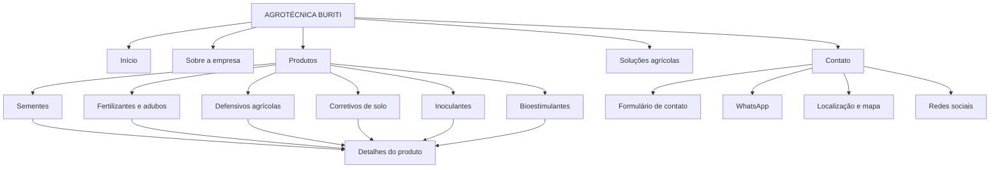

# Arquitetura da Informação — Agrotécnica Buriti

## 1. Objetivo da arquitetura

A arquitetura da informação tem como objetivo organizar as páginas e os conteúdos do site da Agrotécnica Buriti de maneira simples e intuitiva.

A estrutura será voltada principalmente aos produtores rurais e profissionais do agronegócio que desejam conhecer a empresa, consultar seus produtos e entrar em contato com a equipe comercial.

A navegação priorizará três ações principais:

1. Conhecer a Agrotécnica Buriti.
2. Encontrar informações sobre os produtos e soluções agrícolas.
3. Entrar em contato com a empresa.

A organização considera os requisitos funcionais e as seis categorias de produtos definidos no levantamento de requisitos.

---

## 2. Hierarquia das páginas

O site será organizado em cinco páginas principais:

| Nível | Página | Finalidade |
|---|---|---|
| 1 | Início | Apresentar a empresa e destacar seus conteúdos. |
| 1 | Sobre a empresa | Apresentar a história, atuação e valores. |
| 1 | Produtos | Exibir o catálogo de insumos agrícolas. |
| 1 | Soluções agrícolas | Apresentar os serviços e soluções oferecidos. |
| 1 | Contato | Facilitar a comunicação com a empresa. |

A página **Produtos** terá seis categorias e páginas de detalhamento para os produtos cadastrados.

### Estrutura da página Produtos

- Sementes
- Fertilizantes e adubos
- Defensivos agrícolas
- Corretivos de solo
- Inoculantes
- Bioestimulantes

Cada categoria apresentará seus respectivos produtos. Ao selecionar um produto, o visitante poderá acessar uma página com seu nome, descrição e imagem, quando disponível.

---

## 3. Menus e submenus

O menu principal deverá permanecer visível no topo do site, facilitando o acesso às páginas mais importantes.

### Menu principal

- **Início**
- **Sobre a empresa**
- **Produtos**
  - Sementes
  - Fertilizantes e adubos
  - Defensivos agrícolas
  - Corretivos de solo
  - Inoculantes
  - Bioestimulantes
- **Soluções agrícolas**
- **Contato**
- **Fale conosco pelo WhatsApp** (botão de destaque)

No computador, as categorias de produtos poderão aparecer em um submenu suspenso. No celular, serão exibidas em um menu expansível.

---

## 4. Descrição e conteúdo de cada página

### 4.1 Página inicial

**Finalidade:** apresentar a Agrotécnica Buriti e direcionar o visitante para as principais áreas do site.

**Conteúdos:**
- Logotipo e menu principal.
- Imagem de destaque relacionada ao agronegócio.
- Título institucional e breve apresentação da empresa.
- Destaques das categorias de produtos.
- Apresentação resumida das soluções agrícolas.
- Chamada para conhecer a empresa.
- Informações de contato e rodapé.

**Principais CTAs:**
- Conheça a empresa.
- Conheça nossos produtos.
- Fale conosco.

### 4.2 Página Sobre a empresa

**Finalidade:** apresentar a empresa, transmitir credibilidade e aproximar a marca dos visitantes.

**Conteúdos:**
- Apresentação da Agrotécnica Buriti.
- História da empresa, caso disponibilizada.
- Área de atuação no Sudoeste Goiano.
- Missão, visão e valores, se aprovados pela empresa.
- Imagens da estrutura e da equipe, quando disponíveis.

**Principais CTAs:**
- Conheça nossos produtos.
- Entre em contato.

### 4.3 Página Produtos

**Finalidade:** apresentar os principais insumos agrícolas comercializados pela empresa.

**Conteúdos e categorias:**

1. **Sementes:** informações sobre sementes destinadas ao plantio e desenvolvimento das lavouras.
2. **Fertilizantes e adubos:** produtos utilizados para fornecer nutrientes às plantas.
3. **Defensivos agrícolas:** produtos destinados ao controle de pragas, doenças e plantas daninhas.
4. **Corretivos de solo:** produtos utilizados para melhorar as condições do solo para o cultivo.
5. **Inoculantes:** produtos utilizados no tratamento de sementes para favorecer processos biológicos importantes para as culturas.
6. **Bioestimulantes:** produtos que auxiliam no desenvolvimento das plantas.

**Principais CTAs:**
- Ver produtos.
- Conhecer categoria.
- Consultar informações.
- Solicitar informações pelo WhatsApp.

### 4.4 Página de detalhes do produto

**Finalidade:** apresentar informações específicas sobre um produto selecionado no catálogo.

**Conteúdos:**
- Nome do produto.
- Imagem, quando disponível.
- Descrição.
- Categoria à qual pertence.
- Informações complementares aprovadas pela empresa.
- Atalho para retornar à categoria.

**Principais CTAs:**
- Consultar pelo WhatsApp.
- Voltar aos produtos.
- Conhecer outros produtos.

Essa página deverá seguir um modelo padronizado, utilizado para todos os produtos cadastrados.

### 4.5 Página Soluções agrícolas

**Finalidade:** apresentar as soluções agrícolas oferecidas pela Agrotécnica Buriti.

**Conteúdos:**
- Apresentação das soluções oferecidas.
- Explicação sobre como os produtos podem contribuir para as atividades agrícolas.
- Informações sobre o atendimento comercial.
- Imagens relacionadas ao setor agrícola.

Os conteúdos específicos deverão ser confirmados pela empresa antes da publicação.

**Principais CTAs:**
- Conheça nossos produtos.
- Fale com nossa equipe.

### 4.6 Página Contato

**Finalidade:** facilitar a comunicação entre visitantes, produtores rurais e a empresa.

**Conteúdos:**
- Telefone comercial.
- WhatsApp.
- Endereço da empresa.
- E-mail.
- Redes sociais oficiais.
- Mapa com a localização.
- Formulário de contato com nome, e-mail, telefone e mensagem.

**Principais CTAs:**
- Enviar mensagem.
- Conversar pelo WhatsApp.
- Como chegar.
- Acessar redes sociais.

---

## 5. Navegação entre as páginas

A navegação deverá seguir uma estrutura simples, permitindo que o visitante encontre as informações com poucos cliques.

**Fluxo principal de navegação:**

1. O visitante acessa a página inicial.
2. Visualiza a apresentação da Agrotécnica Buriti.
3. Escolhe conhecer a empresa, consultar produtos ou acessar as soluções agrícolas.
4. Se acessar Produtos, seleciona uma das seis categorias.
5. Escolhe um produto para visualizar seus detalhes.
6. Caso tenha interesse, utiliza o botão de WhatsApp ou acessa a página de contato.

**Elementos de navegação complementares:**

- **Logotipo:** retorna à página inicial.
- **Menu principal:** permite acessar todas as páginas.
- **Submenu de produtos:** facilita a escolha de categorias.
- **Breadcrumbs:** mostram o caminho percorrido, por exemplo: Início → Produtos → Sementes → Produto.
- **Rodapé:** disponibiliza links das páginas, contatos e redes sociais.
- **Botão flutuante do WhatsApp:** permanece acessível durante a navegação.

---

## 6. Principais botões e chamadas para ação (CTAs)

| Botão/CTA | Localização | Ação |
|---|---|---|
| Conheça a empresa | Página inicial | Abre a página Sobre. |
| Conheça nossos produtos | Página inicial | Abre o catálogo. |
| Ver categoria | Página Produtos | Abre a categoria selecionada. |
| Consultar informações | Detalhes do produto | Direciona ao contato comercial. |
| Fale conosco | Várias páginas | Abre a página Contato. |
| WhatsApp | Cabeçalho e botão flutuante | Abre o WhatsApp comercial. |
| Enviar mensagem | Página Contato | Envia o formulário preenchido. |
| Como chegar | Página Contato | Permite consultar a localização. |
| Voltar aos produtos | Detalhes do produto | Retorna ao catálogo. |

**Prioridade visual:** o botão de WhatsApp deverá receber destaque, pois representa um dos principais meios de comunicação entre a empresa e os produtores rurais.

---

## 7. Sitemap — Mapa do site em Mermaid

O mapa abaixo representa a estrutura hierárquica das páginas da primeira versão do site.

---

## 8. Organização de funcionalidades futuras

Algumas funcionalidades previstas no levantamento de requisitos não serão necessárias na primeira versão. Elas poderão ser adicionadas posteriormente.

| Funcionalidade futura | Localização sugerida |
|---|---|
| Notícias e novidades | Nova página Notícias |
| Área do cliente | Acesso pelo cabeçalho |
| Pesquisa de produtos | Página Produtos |
| Filtros por categoria | Página Produtos |
| Depoimentos de clientes | Página inicial ou Sobre |
| Galeria de imagens | Página Sobre |
| Newsletter | Rodapé ou página inicial |
| Painel administrativo | Área interna de gerenciamento |
| Integração com sistemas comerciais | Integração interna |

Essas funcionalidades foram previstas como expansões futuras no levantamento original e, portanto, não fazem parte da estrutura obrigatória da primeira versão.

---

## 9. Considerações finais

A arquitetura da informação proposta organiza o site da Agrotécnica Buriti em páginas objetivas, com menus simples e caminhos de navegação claros.

A estrutura prioriza a apresentação institucional, a divulgação dos seis grupos de produtos e a comunicação direta com a empresa. O catálogo permite que o produtor encontre informações por categoria e consulte detalhes dos produtos sem precisar percorrer várias páginas desnecessariamente.

Dessa forma, o site terá uma navegação intuitiva, adequada ao público do agronegócio, além de permitir a inclusão de novas funcionalidades conforme as necessidades futuras da empresa.
